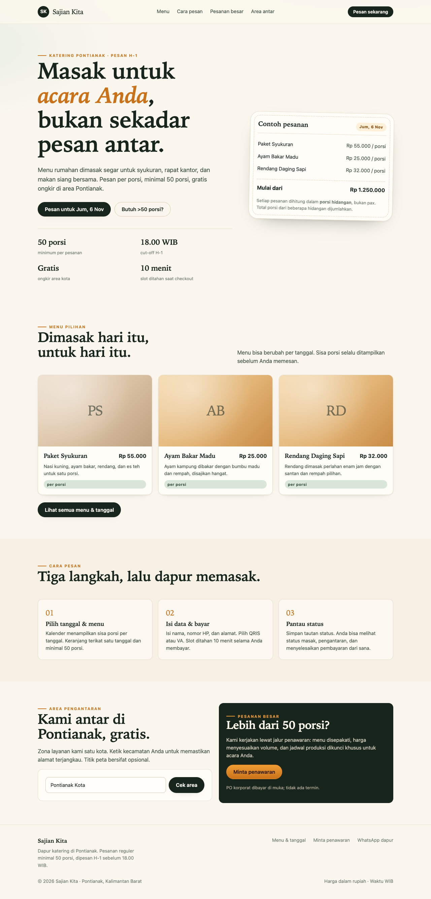
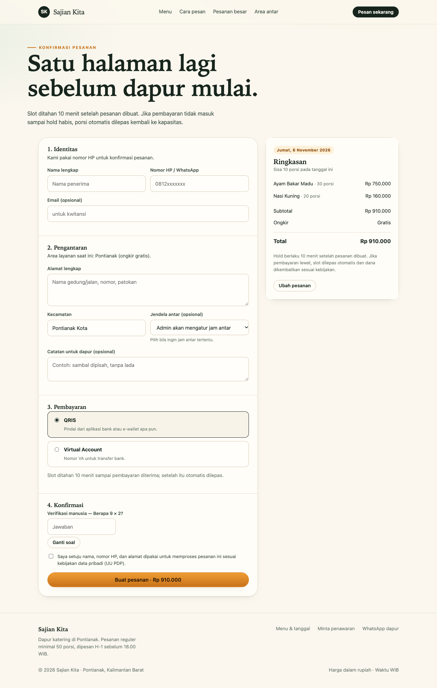
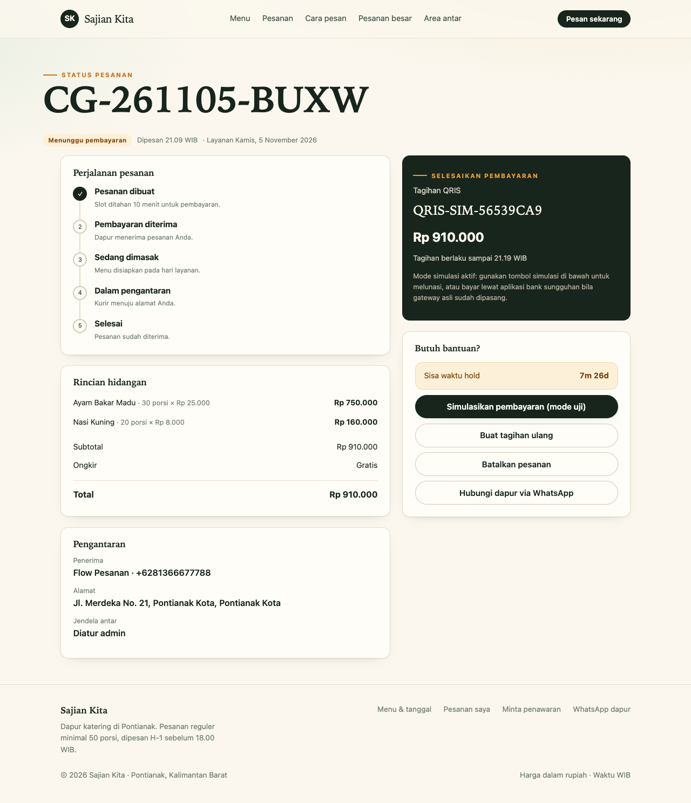
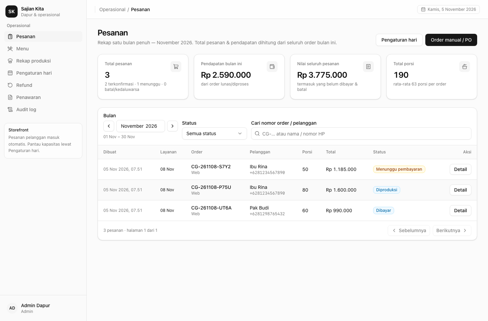
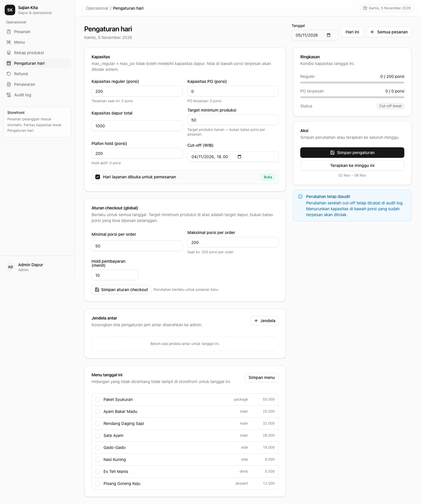
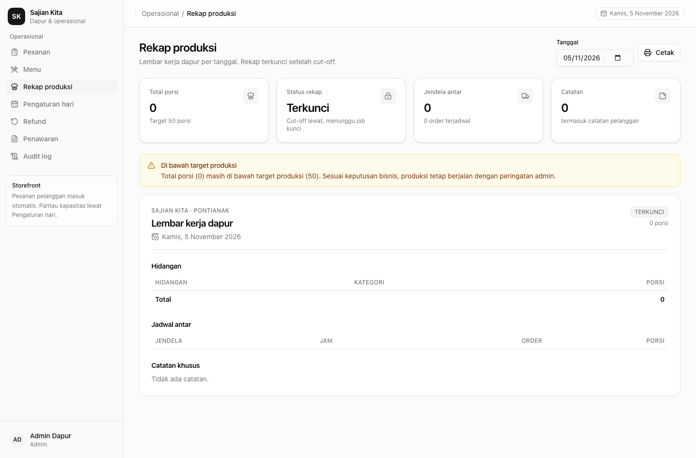
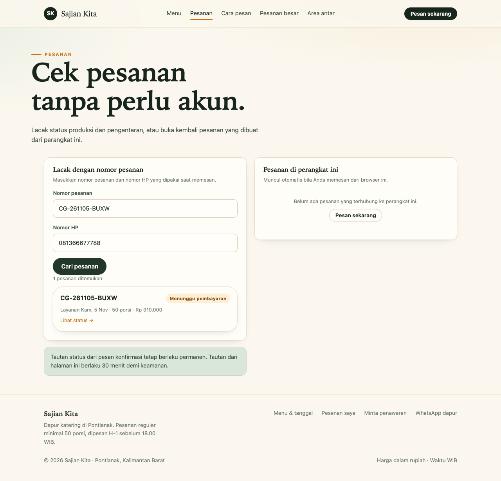
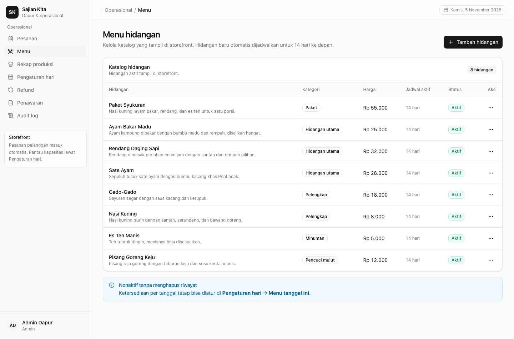

# Platform Catering Online — Monorepo

Implementasi thin slice dari **System Design v2: Platform Catering Online** (PRD revisi CTO,
29 Okt 2026). Satu monolith modular, satu PostgreSQL, tiga frontend untuk tiga persona.

| Persona | Aplikasi | Stack |
| :-- | :-- | :-- |
| Pelanggan | `apps/web` — storefront | Astro 7 (SSR, adapter Node) + SolidJS islands |
| Admin / dapur / kurir | `apps/dashboard` — dashboard internal | TanStack Start + SolidJS + TanStack Query, UI shadcn/ui (Tailwind v4) |
| Sistem | `apps/api` — API + worker | Hono di Node, `ROLE=web` atau `ROLE=worker` |
| Domain | `packages/core` | TypeScript + Drizzle ORM + SQL atomik |
| Kontrak | `packages/contracts` | Zod schema, enum, DTO, label UI |

Build & task runner: **Turborepo** + pnpm workspaces. Database: **PostgreSQL 16**. Antrian latar:
**pg-boss** (tanpa Redis/broker tambahan).

---

## 1. Yang sudah berjalan

- **Kapasitas atomik** per tanggal: `reserved_regular`, `held_regular`, plafon hold, cut-off,
  partisi PO — dijaga satu `UPDATE` bersyarat dalam transaksi yang sama dengan pelepasan hold
  kedaluwarsa (lazy expiry). Diuji **5.000 percobaan konkuren** tanpa melewati `max_regular`.
- **Batas porsi per order** dipisahkan dari target minimum produksi dan dapat diubah admin
  (default 200 porsi); plafon hold hari ke depan otomatis dinaikkan agar order sebesar batas
  tersebut tetap bisa ditahan.
- **Checkout tamu**: sesi tamu (cookie httpOnly), CAPTCHA, `Idempotency-Key`, batas hold per nomor
  dan per IP, minimal 50 porsi, batas porsi per order dapat diatur admin (default 200), hold 10 menit.
- **Pembayaran**: adapter gateway `mock` (QRIS/VA/tunai) dengan webhook bertanda tangan HMAC.
  Idempoten per `event_id`, tahan duplikat, menangani pembayaran telat: re-reserve atomik →
  `paid` bila ada sisa, atau `paid_after_expiry` + refund otomatis diantrekan bila penuh.
- **Refund**: kebijakan manual soft launch — baris `refunds` otomatis `queued`, admin mencatat
  penyelesaian lewat dashboard.
- **Dashboard**: daftar order satu **bulan penuh** dengan widget total pesanan & pendapatan
  bulanan, CRUD menu hidangan (tampil otomatis di storefront), detail order, aksi status satu arah,
  pengaturan hari (kapasitas, cut-off, jendela antar, target minimum, menu per tanggal), rekap
  produksi siap cetak, refund, audit log, penawaran, dan pembuatan order manual/PO. Pengaturan
  hari memakai date picker (default hari ini) dan dapat diterapkan ke satu minggu penuh.
- **Storefront**: beranda, cek area, menu per tanggal dengan sisa porsi, keranjang terikat tanggal,
  checkout, status order dengan hitung mundur & simulasi bayar, halaman **Pesanan** untuk melacak
  pesanan (nomor order + HP atau sesi perangkat), jalur quotation untuk pesanan di atas batas order.
- **Worker**: job pg-boss untuk hold sweep, notifikasi outbox, penguncian rekap produksi,
  pembersihan. Satu image, peran proses berbeda.
- **Anti-bot & rate limit**: hitungan di database (konsisten lintas instance), CAPTCHA tantangan
  bertanda tangan HMAC, OTP adaptif bila riwayat hold kedaluwarsa berulang.

Yang masih mock/placeholder (disengaja untuk thin slice): gateway pembayaran asli, pengiriman
email/WhatsApp, CAPTCHA Turnstile, upload bukti serah terima kurir, PWA kurir, akun & loyalitas.

---

## 2. Prasyarat

**Jalur Docker (disarankan):**

- Docker Engine **24+** dengan Compose (dites Docker 29.2.1 + Compose v5.6.1)
- RAM minimal 4 GB untuk Docker (8 GB bila build semua image sekaligus)

**Jalur native:**

- Node.js **>= 22.23.4** (dites di Node 26.12.1; CI memakai Node 24)
- pnpm **10.x**
- PostgreSQL **16** (lokal, container, atau terkelola)

## 3. Menjalankan

### 3.1 Docker (disarankan)

```bash
cp deploy/env/.env.development.example deploy/env/.env.development
docker compose -f deploy/compose.dev.yml up --build
docker compose --profile seed -f deploy/compose.dev.yml run --rm seed   # sekali, data contoh
```

Dashboard <http://127.0.0.1:3001>, storefront <http://127.0.0.1:4321>, API
<http://127.0.0.1:3000/health>. Database dev dipetakan ke `127.0.0.1:5433` agar tidak bentrok
dengan PostgreSQL native. Panduan lengkap (staging, production, migrasi, backup):
[`docs/docker.md`](docs/docker.md).

### 3.2 Native (tanpa Docker)

```bash
# 1. Dependensi
pnpm install

# 2. Konfigurasi
cp .env.example .env
#    Sesuaikan DATABASE_URL / DATABASE_URL_TEST dengan instance Anda.
#    Contoh untuk Postgres lokal:
#    createdb catering_dev && createdb catering_test (user: catering)

# 3. Skema + data demo
pnpm db:migrate
pnpm db:seed

# 4. Jalankan (terminal terpisah)
pnpm dev:api        # http://127.0.0.1:3000
pnpm dev:web        # http://127.0.0.1:4321
pnpm dev:dashboard  # http://127.0.0.1:3001
pnpm dev:worker     # konsumen pg-boss
```

Atau semua sekaligus: `pnpm dev` (Turbo, paralel).

### Akun demo

| Peran | Email | Password |
| :-- | :-- | :-- |
| Admin | `admin@catering.local` | `admin12345` |
| Dapur | `dapur@catering.local` | `dapur12345` |
| Kurir | `kurir@catering.local` | `kurir12345` |

Seed membuat 8 hidangan, jadwal & kapasitas 14 hari ke depan, jendela antar, satu order
`pending_payment`, satu `paid`, dan satu `in_production` pada H+3.

### Alur demo cepat

1. Buka storefront → pilih tanggal → tambah porsi sampai ≥50 → checkout.
2. Isi data, jawab CAPTCHA, buat pesanan → Anda diarahkan ke halaman status.
3. Klik **“Simulasikan pembayaran (mode uji)”** (hanya non-production) → status menjadi *Lunas*.
4. Buka dashboard → login admin → filter tanggal demo → lihat order, rekap produksi, audit log.

---

## 4. Perintah

| Perintah | Fungsi |
| :-- | :-- |
| `pnpm build` | Build API, storefront, dashboard (Turbo) |
| `pnpm typecheck` | `tsc --noEmit` + `astro check` |
| `pnpm lint` | ESLint + **pemeriksa batas modul** |
| `pnpm test` | Tes unit |
| `pnpm test:integration` | Tes integrasi pada `DATABASE_URL_TEST` |
| `pnpm db:generate` | Generate migrasi Drizzle dari skema |
| `pnpm db:migrate` | Terapkan migrasi |
| `pnpm db:seed` | Seed idempoten (katalog, kapasitas, akun, order demo) |
| `pnpm db:reset` | **Hapus** schema public + migrasi + seed (dev/tes) |
| `pnpm format` | Prettier seluruh repo |
| `pnpm docker:dev:up` | Nyalakan seluruh stack development di Docker |
| `pnpm docker:dev:down` | Hentikan stack development (volume tetap) |
| `pnpm docker:dev:seed` | Seed data contoh ke database Docker dev |
| `pnpm docker:staging:up` | Build + jalankan staging di Docker |
| `pnpm docker:prod:up` | Jalankan production di Docker (butuh env production) |

Tes integrasi memakai database terpisah dan **mereset** schema-nya. Jangan arahkan
`DATABASE_URL_TEST` ke database berisi data penting.

---

## 5. Struktur repo

```
apps/
  api/          Hono: rute publik + admin, middleware, worker pg-boss, entry ROLE
  web/          Astro storefront (SSR) + island SolidJS
  dashboard/    TanStack Start + SolidJS (admin, dapur, kurir)
packages/
  core/         domain: capacity, orders, checkout, payments, refunds, auth, dst.
    src/modules/<modul>/   schema.ts (tabel milik modul) + service.ts + index.ts
    src/db/                client, schema agregat, migrate, reset
    drizzle/               SQL migrasi (termasuk FK fisik terpisah)
    tests/unit|integration
  contracts/    Zod + DTO + enum + label, dipakai ketiga frontend dan API
deploy/         Dockerfile (api/web/dashboard/migrate/dev) + compose dev/staging/prod + env
scripts/        check-boundaries.mjs (lint arsitektur)
docs/           arsitektur, runbook, API, pemetaan PRD
```

### Aturan modul

- Setiap modul memiliki tabelnya sendiri (`schema.ts`) dan hanya mengekspos fungsi publik lewat
  `index.ts`. Impor lintas modul **wajib** `../<modul>/index`, ditegakkan `pnpm lint`.
- Modul lain tidak pernah menulis tabel milik modul lain; kerja lintas modul dilakukan lewat
  fungsi publik (mis. `orders` memanggil `capacity.reservePortions`, bukan SQL kapasitas langsung).
- `packages/core` tidak mengimpor framework web apa pun, sehingga bisa dipakai worker/CLI.
- Aplikasi hanya mengimpor `@catering/core` dan `@catering/contracts`, bukan `.../src/...`.

---

## 6. Keputusan desain penting

**Kapasitas & hold.** `daily_capacity` adalah baris atomik per tanggal. Reservasi berjalan dalam
satu transaksi: (1) `UPDATE orders ... RETURNING` melepas hold kedaluwarsa tanggal itu, (2) satu
`UPDATE daily_capacity` bersyarat menambah `reserved_*`/`held_*` hanya jika masih di bawah
`max_*` dan `hold_ceiling`. Kebenaran tidak bergantung pada worker; job hanya pembersih.

**Idempotensi.** Klien wajib mengirim `Idempotency-Key` saat `POST /orders`. Server mengklaim kunci
atomik, memutar ulang respons identik untuk permintaan yang sama, dan menolak kunci yang dipakai
dengan payload berbeda. Token tautan status diturunkan dengan HMAC (tidak disimpan mentah).

**Pembayaran telat.** Webhook idempoten per `event_id`. Bila order sudah kedaluwarsa, server
melepas hold lalu mencoba reservasi ulang atomik. Berhasil → `paid`. Penuh → `paid_after_expiry`,
refund otomatis diantrekan, pelanggan diberi tahu.

**Rate limit tanpa Redis.** Hitungan disimpan di tabel `rate_limits` dengan UPSERT dan jendela
waktu tetap. Konsisten lintas instance dan tidak reset saat deploy.

**Satu image, dua peran.** `ROLE=web` menjalankan HTTP; `ROLE=worker` menjalankan pg-boss.
Deploy worker sebagai container kecil dari image yang sama.

**Uang & waktu.** Semua nominal adalah bilangan bulat rupiah. Tanggal layanan adalah tanggal
kalender WIB; timestamp disimpan `timestamptz` dan ditampilkan dengan offset `+07:00`.

**Keamanan.** Catatan pelanggan selalu dirender sebagai teks (di-escape framework). API mengirim
header keamanan; storefront mengirim CSP baseline. Origin dashboard terpisah dan ditandai
`noindex`. Sesi dashboard (cookie httpOnly, hash di DB, 8 jam) + RBAC `admin|kitchen|courier`.

---

## 7. Status terhadap roadmap PRD

| Fase | Status |
| :-- | :-- |
| 0 — keputusan bisnis & konfigurasi | Sebagian besar default terkunci ada di tabel `settings`; nilai bisa diubah admin/seed |
| 1a — repo/CI/skema/kapasitas atomik | Selesai; tes konkurensi 5.000 lolos |
| 1b — alur tamu, menu, anti-bot dasar | Selesai; CAPTCHA & rate limit database |
| 1c — checkout, hold, webhook, job expiry, notifikasi | Selesai dengan gateway & kanal mock |
| 1d — dashboard admin, rekap, audit, refund manual, load test, restore | Dashboard/rekap/audit/refund selesai; load test HTTP & uji restore masih manual (lihat runbook) |
| 2 — kurir PWA, refund otomatis, ubah order, invoice, quotation/PO, multi-tanggal | Belum; tabel & endpoint dasar quotation/PO sudah disiapkan |
| 3 — akun & loyalitas, read replica, pemecahan aplikasi | Belum |

## 8. Tangkapan layar

| Storefront | Checkout | Status pesanan |
| :-- | :-- | :-- |
|  |  |  |

| Dashboard pesanan (bulanan) | Pengaturan hari | Rekap produksi |
| :-- | :-- | :-- |
|  |  |  |

| Pesanan saya (storefront) | Kelola menu (dashboard) |
| :-- | :-- |
|  |  |

Rincian pemetaan per bagian PRD: [`docs/prd-mapping.md`](docs/prd-mapping.md).
Arsitektur & alur: [`docs/architecture.md`](docs/architecture.md).
Operasional: [`docs/runbook.md`](docs/runbook.md).
Kontrak API: [`docs/api.md`](docs/api.md).
Design system dashboard: [`docs/dashboard-ui.md`](docs/dashboard-ui.md).
Docker (dev/staging/production): [`docs/docker.md`](docs/docker.md).

---

## 9. Variabel environment

Lihat `.env.example`. Ringkasnya:

| Variabel | Wajib | Keterangan |
| :-- | :-- | :-- |
| `DATABASE_URL` | ya | Koneksi PostgreSQL aplikasi |
| `DATABASE_URL_TEST` | tes | Database terpisah untuk tes integrasi |
| `SESSION_SECRET` | produksi | 32+ byte; menandatangani token status & OTP |
| `CAPTCHA_SECRET` | produksi | HMAC tantangan CAPTCHA |
| `PAYMENT_GATEWAY` | tidak | `mock` (default) |
| `PAYMENT_WEBHOOK_SECRET` | produksi | Verifikasi signature webhook |
| `APP_URL` / `DASHBOARD_URL` | ya | Origin storefront & dashboard (CORS & tautan status) |
| `ROLE` | worker | `web` atau `worker` |
| `ADMIN_EMAIL` / `ADMIN_PASSWORD` | seed | Akun admin awal |

---

## 10. Menuju production (hal yang harus diganti)

1. **Gateway asli** — implementasikan `PaymentGateway` (Midtrans/Xendit) dan verifikasi signature
   sesuai dokumentasi gateway; `PAYMENT_GATEWAY` sudah menjadi saklar.
2. **Notifikasi nyata** — sambungkan outbox ke SMTP/WhatsApp Business API di worker.
3. **CAPTCHA Turnstile** — set `CAPTCHA_PROVIDER=turnstile` + `TURNSTILE_SECRET_KEY`.
4. **CSP di edge** — pindahkan CSP ke Cloudflare dengan nonce dan aktifkan WAF rate limit per IP.
5. **Load test HTTP & uji restore** — jalankan skenario PRD §11 (≈280 rps CDN / 56 rps origin),
   catat RPO/RTO sebenarnya.
6. **Image & deploy** — gunakan compose terpisah untuk staging dan production; build image dengan
   tag versi, jalankan migrasi sebagai service one-shot, lalu naikkan versi. Panduan lengkap:
   [`docs/docker.md`](docs/docker.md).

---

Handoff sesi terakhir (status server, keputusan, data lokal, langkah berikutnya):
[`docs/session-summary.md`](docs/session-summary.md).
