# Dashboard — Design System shadcn/ui

Dokumen ini menjelaskan bagaimana dashboard internal (`apps/dashboard`) diubah dari UI bawaan
menjadi design system **shadcn/ui**, apa saja komponen yang dipakai, dan bagaimana menambah atau
mengubah komponen tanpa merusak alur bisnis.

> **Catatan penting.** Dashboard berjalan di **SolidJS** (TanStack Start + Solid), sedangkan
> shadcn/ui resminya adalah komponen **React**. Karena itu yang diadopsi adalah **design
> language-nya** (token warna, radius, tipografi, pola komponen, dan perilaku), lalu komponen
> shadcn ditulis ulang sebagai komponen Solid di `src/components/ui`. Interaksi kompleks
> (dialog, select, dropdown, checkbox) memakai primitif **Kobalte** — pustaka headless aksesibel
> untuk Solid yang menjadi padanan Radix UI di dunia React.

---

## 1. Ruang lingkup

| Berubah | Tidak berubah |
| :-- | :-- |
| Seluruh tampilan dashboard: layout, sidebar, header, kartu, tabel, form, dialog, badge, toast | Query TanStack Query, endpoint API, aturan kapasitas, autentikasi, RBAC, audit log |
| CSS global (dari CSS kustom → Tailwind v4 + token shadcn) | Skema database, migrasi, worker, storefront |
| Form menu kini di **Dialog**, aksi baris di **DropdownMenu**, pembatalan order & penerapan mingguan memakai dialog konfirmasi | Validasi server, idempotensi, dan transisi status |

Hasil verifikasi: `pnpm lint`, `pnpm typecheck`, dan `pnpm build` untuk `apps/dashboard` hijau;
seluruh halaman diuji di browser (desktop 1440×950 dan mobile 390×844).

---

## 2. Stack UI

| Paket | Versi | Fungsi |
| :-- | :-- | :-- |
| `tailwindcss` + `@tailwindcss/vite` | 4.3.4 | Utility CSS, tema `@theme inline`, content scanning otomatis |
| `@kobalte/core` | 0.13.14 | Primitif headless: Select, Dialog, AlertDialog, DropdownMenu, Checkbox |
| `class-variance-authority` | 0.7.1 | Varian komponen (`buttonVariants`, `badgeVariants`, `alertVariants`) |
| `clsx` + `tailwind-merge` | 2.1.1 / 3.7.0 | Helper `cn()` untuk menggabungkan class tanpa konflik |
| `lucide-solid` | 1.68.0 | Ikon (padanan `lucide-react`) |
| `tw-animate-css` | 1.4.0 | Animasi masuk/keluar untuk dialog, select, dropdown (`animate-in`, `fade-in-0`, dst.) |

Konfigurasi Vite (`apps/dashboard/vite.config.ts`):

```ts
plugins: [tailwindcss(), tanstackStart(), viteSolid({ ssr: true }), nitro()]
```

---

## 3. Struktur file

```text
apps/dashboard/src/
├── styles/app.css              # token shadcn, base layer, style cetak
├── lib/cn.ts                   # clsx + tailwind-merge
├── components/
│   ├── AppShell.tsx            # sidebar + header + konten, sesi & logout
│   ├── StatusBadge.tsx         # status order → varian badge
│   ├── stat-card.tsx           # kartu statistik ringkas
│   └── ui/                     # komponen design system (lihat tabel)
└── routes/                     # 10 halaman dashboard
```

---

## 4. Token & tema

Token mengikuti shadcn/ui base color **neutral**, mode **light only** (sesuai permintaan).
Semua nilai didefinisikan di `:root` pada `app.css` lalu dipetakan ke utility Tailwind lewat
`@theme inline`.

| Token | Fungsi | Contoh pemakaian |
| :-- | :-- | :-- |
| `--background` / `--foreground` | Kanvas & teks utama | `bg-background`, `text-foreground` |
| `--card` / `--card-foreground` | Permukaan kartu | `bg-card`, `text-card-foreground` |
| `--popover` / `--popover-foreground` | Dropdown, select, dialog | `bg-popover` |
| `--primary` / `--primary-foreground` | Aksi utama, tombol default | `bg-primary`, `text-primary-foreground` |
| `--secondary` | Aksi sekunder, badge netral | `bg-secondary` |
| `--muted` / `--muted-foreground` | Latar halus, teks deskripsi | `bg-muted/40`, `text-muted-foreground` |
| `--accent` | Hover item menu/nav | `hover:bg-accent` |
| `--destructive` | Aksi berbahaya (batalkan, error) | `bg-destructive` |
| `--border`, `--input`, `--ring` | Garis, border input, focus ring | `border-border`, `focus-visible:ring-ring/50` |
| `--sidebar` dan turunannya | Sidebar & item aktif | `bg-sidebar`, `bg-sidebar-accent` |
| `--radius` (0.625rem) | Radius turunan `sm/md/lg/xl` | `rounded-md`, `rounded-xl` |

Tipografi memakai stack sans sistem (tanpa unduhan font eksternal) agar dashboard tetap ringan
dan tidak bergantung CDN. Angka nominal selalu memakai `tabular-nums`.

**Menambah dark mode di masa depan:** tambahkan blok `:root.dark { … }` (token shadcn dark) dan
pasang class `dark` pada `<html>`; seluruh komponen yang sudah memakai token akan ikut berubah
tanpa edit per komponen.

---

## 5. Inventaris komponen

Semua berada di `apps/dashboard/src/components/ui/`.

| Komponen shadcn/ui | File | Primitif | Dipakai di |
| :-- | :-- | :-- | :-- |
| Button | `button.tsx` | `<button>` + CVA | Semua halaman, toolbar, footer dialog |
| Badge | `badge.tsx` | `<span>` + CVA | Status order, status menu/refund, hitungan |
| Card (+ Header/Title/Description/Action/Content/Footer) | `card.tsx` | `<div>` | Semua halaman |
| Input | `input.tsx` | `<input>` | Form, filter tanggal/pencarian |
| Textarea | `textarea.tsx` | `<textarea>` | Catatan, deskripsi menu, alasan batal |
| Label | `label.tsx` | `<label>` | Semua field |
| Select | `select.tsx` | Kobalte Select | Filter status/entitas, kategori, pembayaran, hidangan |
| Checkbox | `checkbox.tsx` | Kobalte Checkbox | Menu aktif, hari buka, ketersediaan menu |
| Table (+ Header/Body/Row/Head/Cell) | `table.tsx` | `<table>` | Pesanan, menu, audit, refund, penawaran, detail order |
| Alert (+ Title/Description) | `alert.tsx` | `<div>` + CVA | Error, info, warning (5 varian) |
| Dialog | `dialog.tsx` | Kobalte Dialog | Form menu, alasan pembatalan |
| AlertDialog | `alert-dialog.tsx` | Kobalte AlertDialog | Konfirmasi terapkan ke seminggu |
| DropdownMenu | `dropdown-menu.tsx` | Kobalte DropdownMenu | Aksi baris menu, menu pengguna (logout) |
| Sheet | `sheet.tsx` | Kobalte Dialog | Navigasi mobile dari kiri |
| Separator | `separator.tsx` | `<div role="separator">` | Header, ringkasan |
| Progress | `progress.tsx` | `<div role="progressbar">` | Kapasitas reguler/PO di pengaturan hari |
| Skeleton | `skeleton.tsx` | `<div>` | Tersedia untuk loading state |
| Toast | `toast.tsx` | Custom | Notifikasi sukses setelah aksi |
| EmptyState | `empty-state.tsx` | Custom | Tabel kosong, halaman gagal muat |
| StatCard | `../stat-card.tsx` | Custom (Card) | Pesanan & rekap produksi |

---

## 6. Pola pemakaian

### 6.1 Tombol dan tautan bergaya tombol

`Button` adalah `<button>`; untuk navigasi gunakan `Link` + `buttonVariants` agar tetap berupa
anchor (SEO, middle-click, aksesibilitas).

```tsx
import { Link } from '@tanstack/solid-router';
import { Button, buttonVariants } from '~/components/ui/button';

<Button onClick={openCreate}>
  <Plus /> Tambah hidangan
</Button>

<Link class={buttonVariants({ variant: 'outline' })} to="/">
  <ArrowLeft /> Semua pesanan
</Link>
```

Varian: `default`, `destructive`, `outline`, `secondary`, `ghost`, `link`.
Ukuran: `default`, `sm`, `lg`, `icon`, `icon-sm`.

### 6.2 Select terkontrol

Select tidak memakai `<select>` native; nilainya tetap string agar kompatibel dengan state yang
sudah ada.

```tsx
<Select
  id="status"
  value={status()}
  onChange={(value) => {
    setStatus(value);
    setPage(1);
  }}
  options={[
    { value: '', label: 'Semua status' },
    { value: 'paid', label: 'Dibayar' },
  ]}
  aria-label="Filter status pesanan"
/>
```

Nilai kosong (`''`) ditampilkan sebagai placeholder/nilai "Semua". Selalu isi `aria-label` atau
kaitkan dengan `Label`.

### 6.3 Dialog form

Form menu sekarang berada di dialog. `DialogTitle` **wajib** ada untuk aksesibilitas
(dibaca screen reader saat dialog dibuka).

```tsx
<Dialog open={editing() !== null} onOpenChange={(open) => { if (!open) closeForm(); }}>
  <DialogContent class="sm:max-w-2xl">
    <DialogHeader>
      <DialogTitle>Hidangan baru</DialogTitle>
      <DialogDescription>Perubahan berlaku untuk storefront.</DialogDescription>
    </DialogHeader>
    <form id="menu-form" onSubmit={save}>…</form>
    <DialogFooter>
      <Button variant="outline" onClick={closeForm}>Batal</Button>
      <Button type="submit" form="menu-form">Simpan</Button>
    </DialogFooter>
  </DialogContent>
</Dialog>
```

### 6.4 AlertDialog untuk konfirmasi

Aksi destruktif/massal memakai `AlertDialog` (bukan `window.confirm`), dengan tombol batal yang
eksplisit.

### 6.5 Dropdown aksi baris

```tsx
<DropdownMenu>
  <DropdownMenuTrigger aria-label={`Aksi untuk ${item.name}`}>
    <MoreHorizontal />
  </DropdownMenuTrigger>
  <DropdownMenuContent class="w-44">
    <DropdownMenuItem onSelect={() => openEdit(item)}><Pencil /> Edit</DropdownMenuItem>
    <DropdownMenuSeparator />
    <DropdownMenuItem onSelect={() => void toggleActive(item)}><Power /> Nonaktifkan</DropdownMenuItem>
  </DropdownMenuContent>
</DropdownMenu>
```

### 6.6 Tabel

Tabel lebar diberi `min-w-[…]` pada `Table` dan berada di dalam `overflow-x-auto`, sehingga di
layar kecil tabel bisa digeser horizontal alih-alih memecah kolom. Kepala tabel memakai latar
`bg-muted/40`.

### 6.7 Feedback

- `Alert` varian `destructive`, `warning`, `info`, `success` untuk pesan kontekstual.
- `Toast` untuk konfirmasi singkat setelah aksi (3 detik).
- `EmptyState` untuk tabel kosong dengan ikon, judul, deskripsi, dan aksi opsional.

---

## 7. Layout & responsif

`AppShell` menyediakan:

- **Sidebar tetap 256px** (`md:flex`) dengan brand, grup navigasi "Operasional", kartu konteks
  storefront, dan menu pengguna (DropdownMenu → Keluar).
- **Sheet mobile** dari kiri; tombol hamburger hanya tampil < `md`.
- **Header sticky** 56px: breadcrumb `Operasional / <halaman>`, chip tanggal hari ini (≥ `lg`),
  avatar + logout untuk mobile.
- **Konten** maksimal 1440px, padding responsif, judul halaman + deskripsi + slot aksi.
- Halaman dua kolom (`Pesanan`, detail order, pengaturan hari, order manual) memakai
  `lg:grid-cols-[minmax(0,1.6fr)_minmax(0,1fr)]` dan otomatis menumpuk di layar kecil.
- Grid statistik: 1 kolom → 2 (`sm`) → 4 (`xl`).

---

## 8. Mode cetak

Rekap produksi tetap dapat dicetak:

- `data-slot="sidebar"`, `data-slot="header"`, dan `data-slot="app-main"` ditangani di
  `@media print` (`app.css`).
- Elemen interaktif diberi class `no-print` (toolbar tanggal, tombol cetak, kartu statistik).
- `.print-sheet` menghapus border/bayangan saat dicetak dan mempertahankan tabel hitam-putih.
- Header halaman, sidebar, dan toolbar diberi `no-print` / `data-slot` sehingga hasil cetak hanya
  berisi lembar kerja dapur.

Contoh hasil (emulasi media `print`): 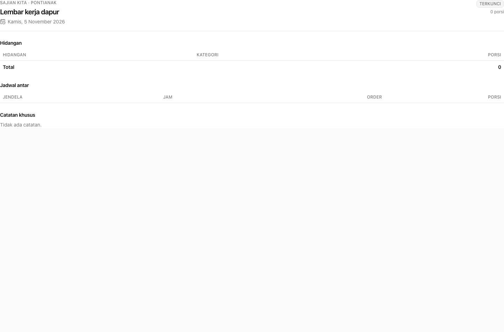

---

## 9. Aksesibilitas

- Focus ring konsisten `focus-visible:ring-[3px] ring-ring/50`.
- Dialog/Sheet/AlertDialog/Select/Dropdown dari Kobalte: focus trap, ESC, ARIA, keyboard nav.
- Setiap trigger ikon-only memiliki `aria-label` (mis. `Filter status pesanan`, `Aksi untuk …`).
- Tabel memakai `<th>` untuk kolom; status tidak hanya dibedakan warna (teks label ikut tampil).
- `aria-current="page"` pada item navigasi aktif.
- Angka uang memakai `tabular-nums` agar mudah dibandingkan.

---

## 10. Menambah komponen shadcn baru

1. Ambil referensi komponen dari [ui.shadcn.com](https://ui.shadcn.com/docs/components) (React)
   atau port Solid-nya, lalu tulis ulang di `components/ui/<nama>.tsx`.
2. Gunakan `data-slot="…"` dan `cn()`; pertahankan nama token (`bg-card`, `text-muted-foreground`,
   dst.) agar tema konsisten.
3. Untuk interaksi, pakai primitif Kobalte yang sesuai dan pastikan bisa SSR (portal hanya
   dirender saat terbuka).
4. Tambahkan entri di tabel inventaris dokumen ini dan, bila perlu, contoh pemakaian.
5. Jalankan `pnpm --filter @catering/dashboard lint` lalu uji keyboard & mobile.
6. Jalankan `pnpm --filter @catering/dashboard typecheck` lalu uji keyboard & mobile.
7. Jalankan `pnpm --filter @catering/dashboard build` lalu uji keyboard & mobile.

---

## 11. Verifikasi

```bash
pnpm --filter @catering/dashboard lint
pnpm --filter @catering/dashboard typecheck
pnpm --filter @catering/dashboard build
```

Checklist manual yang sudah dijalankan:

- Login/logout, redirect 401, menu pengguna.
- Daftar pesanan: filter bulan/status/pencarian, pagination, klik baris.
- Menu: buka dialog tambah/edit, simpan, aktif/nonaktifkan via dropdown.
- Detail order: ubah status, catatan internal, dialog pembatalan (validasi alasan wajib).
- Pengaturan hari: kapasitas, aturan checkout, jendela antar, menu per tanggal, konfirmasi
  terapkan seminggu.
- Rekap produksi: tampilan layar + tombol cetak.
- Refund, penawaran, audit log.
- Order manual/PO: form, ringkasan, state sukses.
- Mobile: navigasi Sheet, tabel dapat digeser, form menumpuk.

---

## 12. Screenshot

| Halaman | Tangkapan |
| :-- | :-- |
| Login | 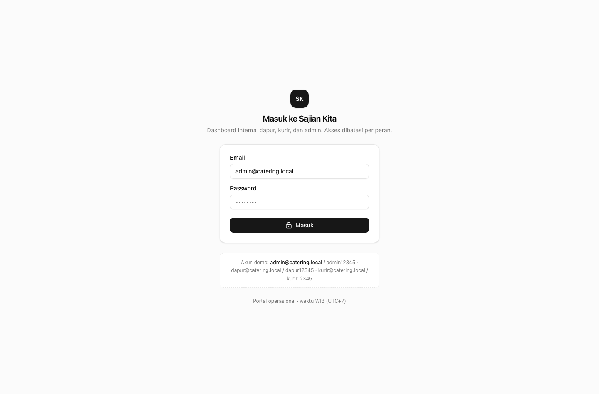 |
| Pesanan |  |
| Menu + dialog | 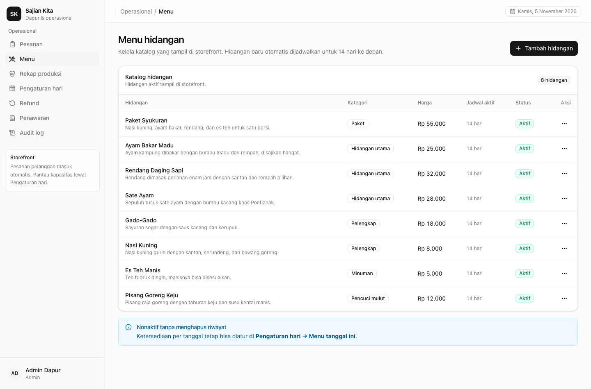 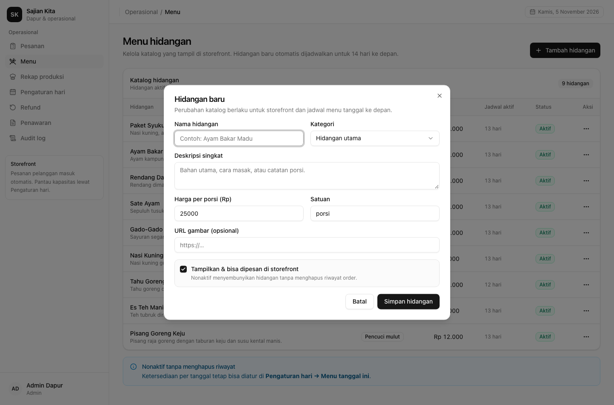 |
| Detail order & dialog batal | 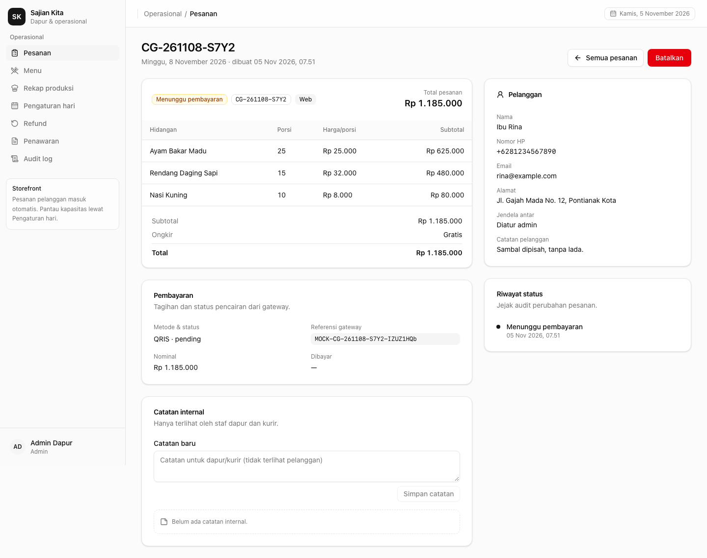 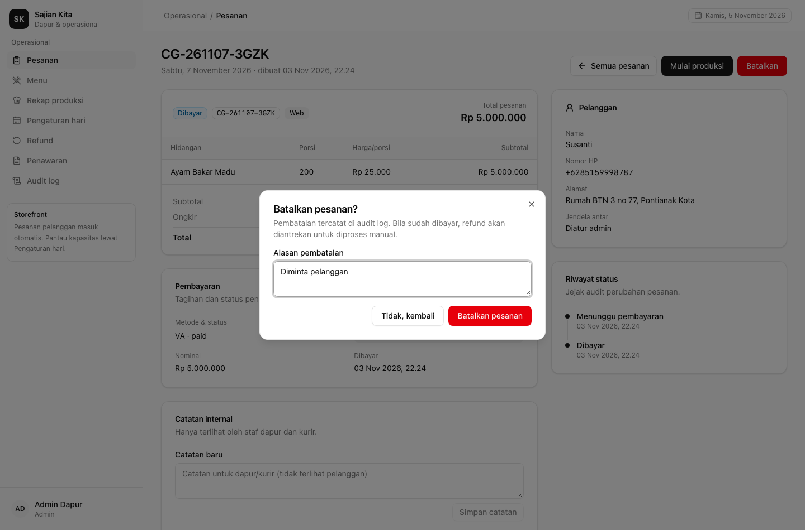 |
| Pengaturan hari | 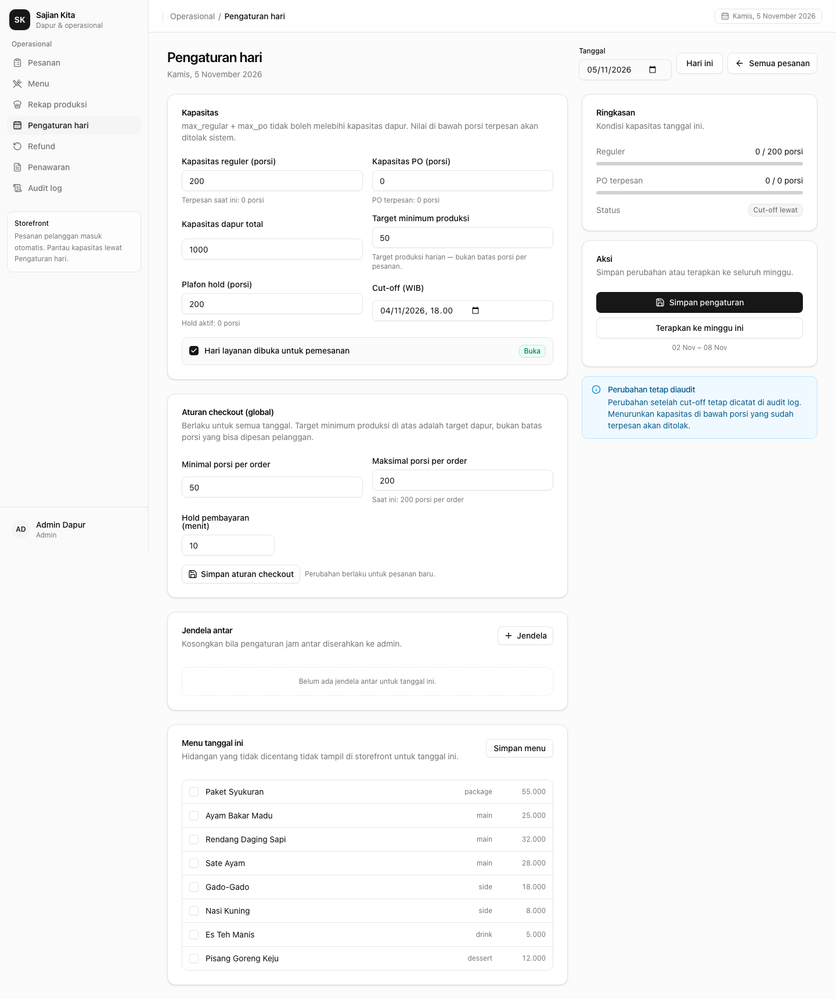 |
| Rekap produksi | 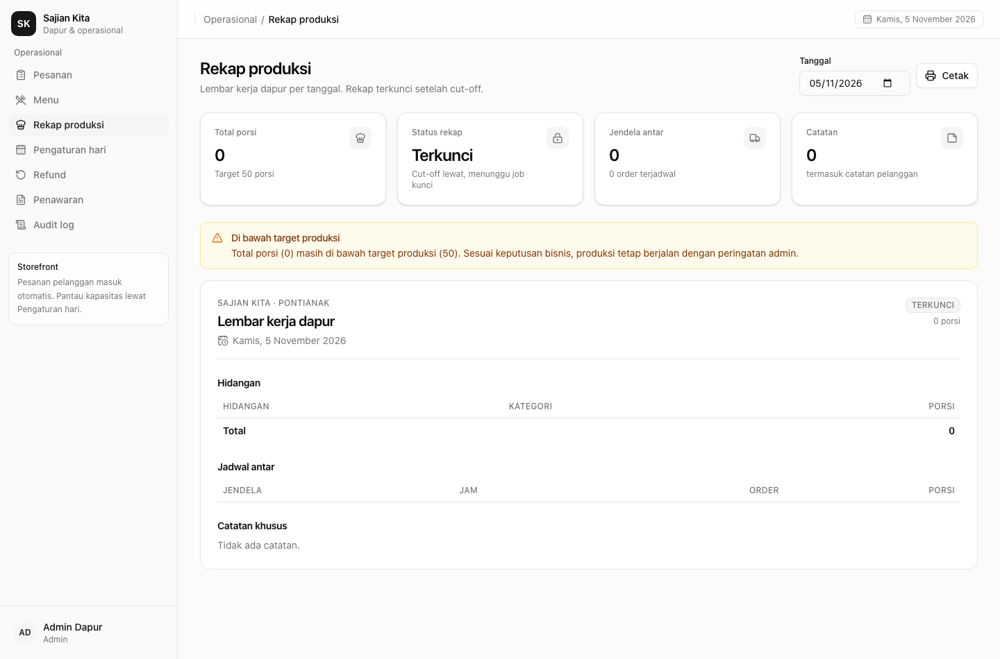 |
| Order manual / PO | 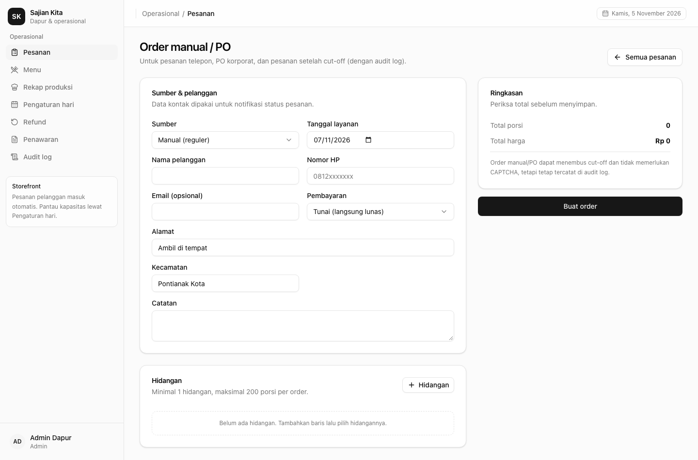 |
| Refund | 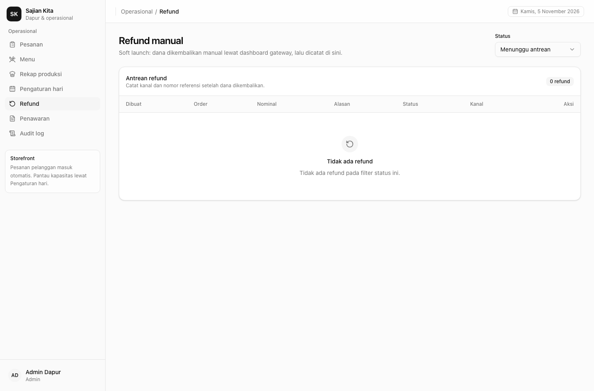 |
| Audit log | 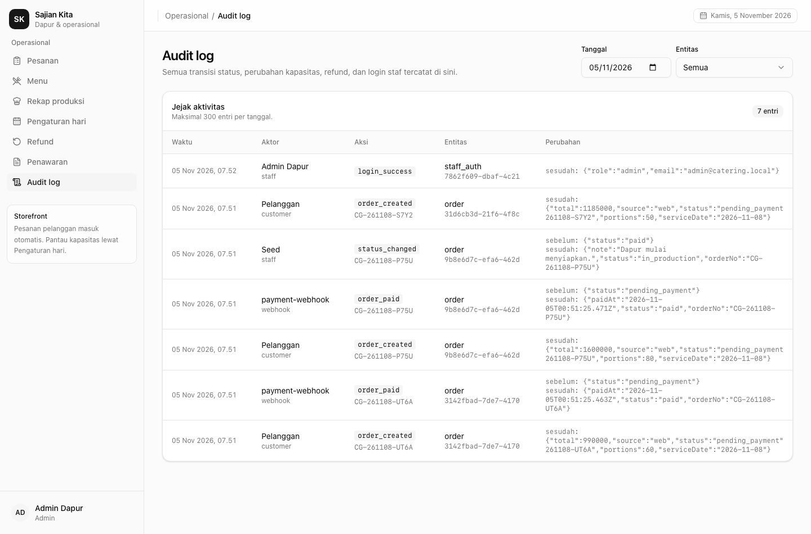 |
| Select terbuka | 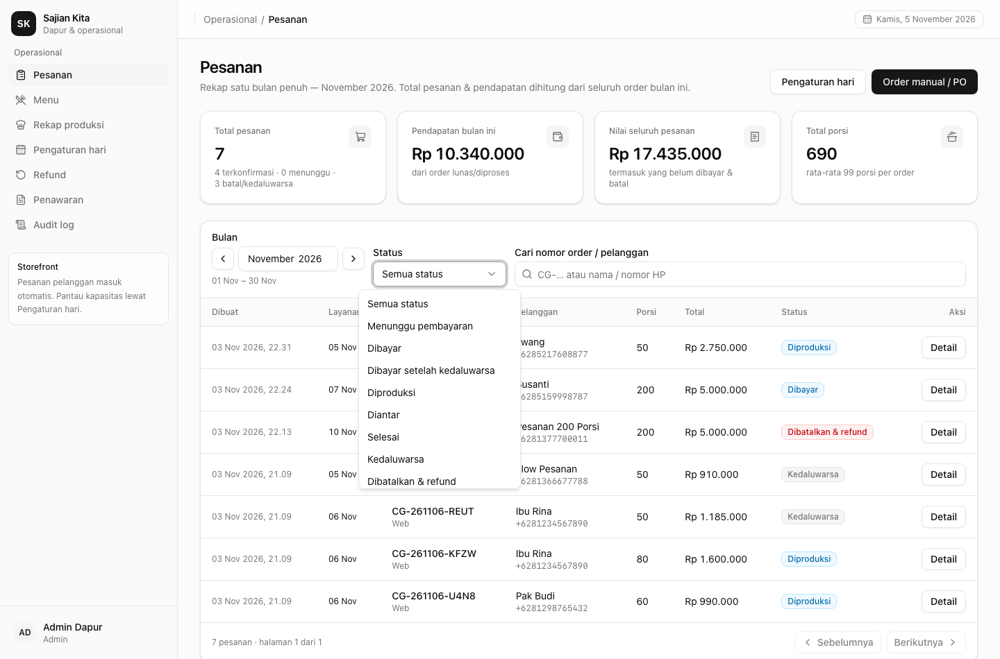 |
| Mobile | 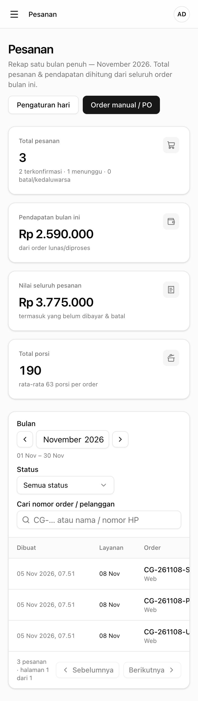 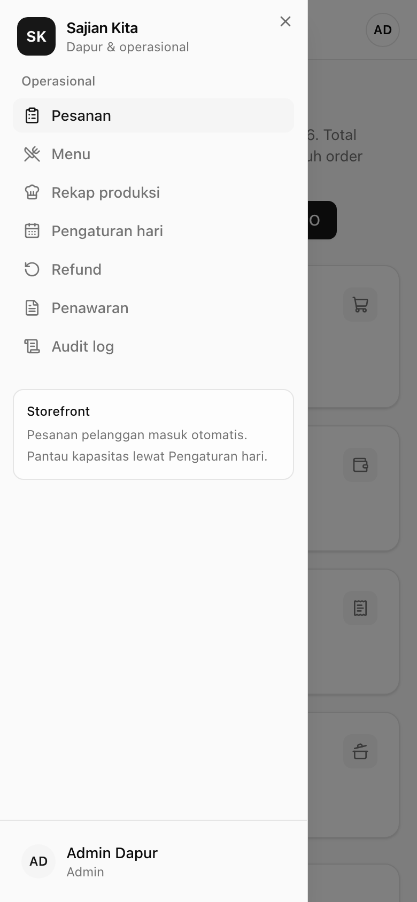 |
| Build production (staging) | 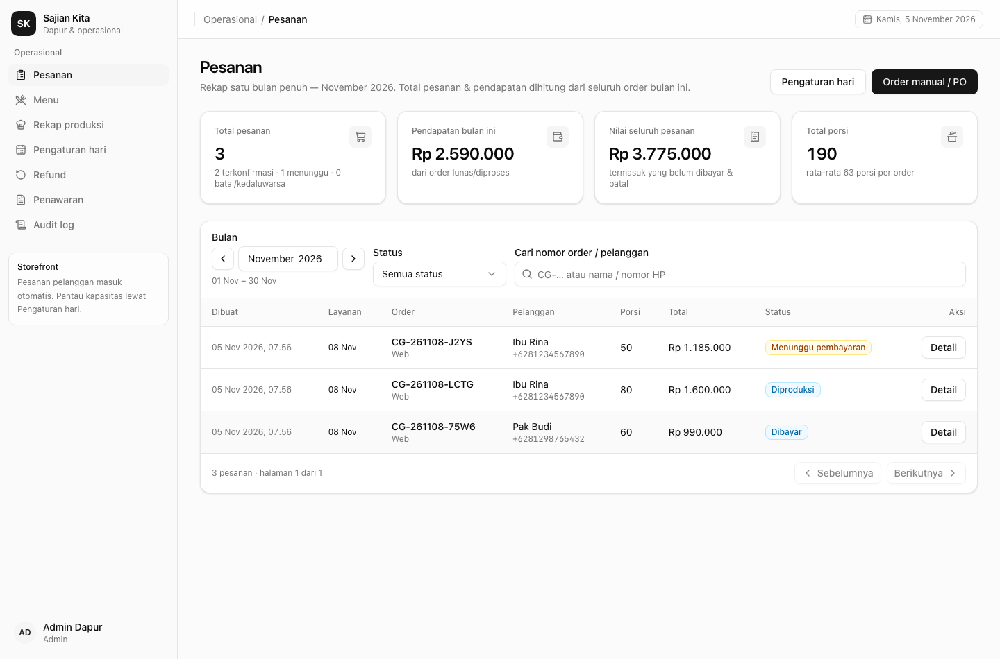 |

---

## 13. Batasan & rekomendasi lanjutan

- **Light mode saja** sesuai permintaan; token dark belum dibuat.
- Input tanggal/jam masih memakai kontrol native browser (belum ada komponen Calendar/Popover
  shadcn). Cukup untuk kebutuhan admin saat ini.
- Tabel lebar memakai scroll horizontal di mobile; bila ingin UX yang lebih baik, buat card list
  terpisah untuk < `md`.
- Toast masih minimal (bukan Sonner) — cukup untuk satu pesan sukses/error pada satu waktu.
- Belum ada visual regression test; screenshot di dokumen ini dipakai sebagai baseline manual.
- Bila jumlah kolom/aksi bertambah banyak, pertimbangkan TanStack Table + komponen shadcn
  DataTable (sorting, column visibility).
